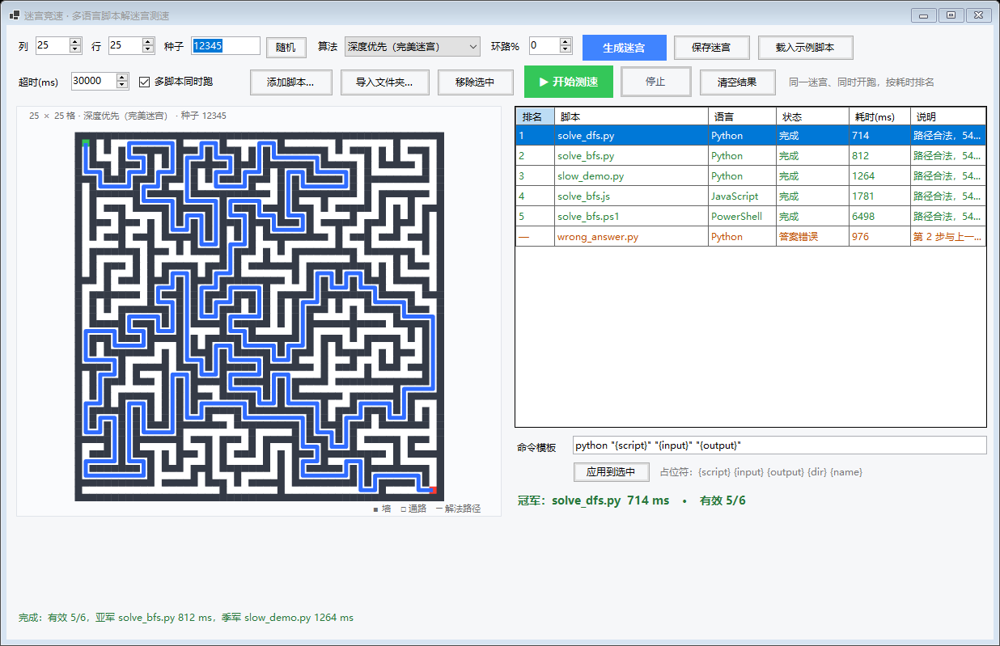

# 迷宫竞速（MazeRacer）

多语言脚本解迷宫的**测速台**：先按尺寸生成迷宫，再让不同语言的脚本同时开跑，自动校验路径是否合法，最后按耗时排名。

- 迷宫尺寸、种子、生成算法、环路比例都可自选
- 自动按扩展名识别脚本语言，给出默认启动命令；没有默认命令的语言也能自己填
- 支持任意数量脚本**同时开跑**（也可切换为依次跑，计时更公平）
- 每个脚本跑在独立工作目录里，互不干扰
- 输出路径逐格校验（越界、穿墙、跳格都会判错）
- 结束后显示排名、耗时、状态与错误原因



## 下载

到 [Releases](../../releases) 下载现成版本，两个功能完全一样：

| 文件 | 说明 |
| --- | --- |
| `MazeRacer-*-windows-x64-portable.exe` | 便携版，自带 .NET 运行时（约 54 MB），复制到任意 64 位 Windows 10/11 直接运行 |
| `MazeRacer-*-windows-x64-slim.exe` | 精简版（约 24 MB），需要本机安装 .NET 9 桌面运行时（x64） |

便携版首次启动会自解压到临时目录，慢 1~3 秒属正常；exe 未签名，SmartScreen 提示时点「更多信息 → 仍要运行」。

## 快速开始

1. 双击下载的 exe（也可以按下方「从源码构建」自己打包）。
2. 设置「列 / 行」（4~200），点 **生成迷宫**。
3. 点 **载入示例脚本**（把仓库里的 `samples/` 放到 exe 同目录），或 **添加脚本 / 导入文件夹**。
4. 点 **▶ 开始测速**。

## 迷宫格式

生成/保存的迷宫是纯文本，第一行是尺寸，后面是 `2*行+1` 行字符画：

```text
25 25
###################################################
#S# #         #     #       #       #       #     #
# # # ### ### # ### # ##### # ##### # ##### # ### #
...
#                                               E#
###################################################
```

- `#` 墙、空格通路、`S` 起点（左上）、`E` 终点（右下）
- 列数、行数指“格子数”，字符画宽度为 `2*列+1`、高度为 `2*行+1`
- 坐标为字符网格坐标，从 0 开始

## 脚本协议（所有语言通用）

启动命令会把两个路径传给脚本：

| 占位符 | 含义 |
| --- | --- |
| `{script}` | 脚本文件的绝对路径 |
| `{input}` | 迷宫文本的绝对路径（argv[1] 位置） |
| `{output}` | 结果文件的绝对路径（argv[2] 位置） |
| `{dir}` | 该脚本本次运行的独立工作目录 |
| `{name}` | 脚本文件名 |

脚本要做的事很简单：读迷宫 → 求路径 → 把路径按 `x y` 每行一个坐标写进 `{output}`：

```text
1 1
2 1
2 2
...
47 47
```

- 必须从 `S` 走到 `E`
- 相邻两步只能上下左右移动一格
- 不能穿墙、不能越界
- 不要求最短，BFS/DFS/A* 都行

## 支持的语言（自动识别）

| 扩展名 | 语言 | 默认命令（可改） |
| --- | --- | --- |
| `.py` `.pyw` | Python | `python "{script}" "{input}" "{output}"` |
| `.js` `.mjs` | JavaScript | `node ...` |
| `.ts` | TypeScript | `npx ts-node ...` |
| `.ps1` | PowerShell | `pwsh -NoProfile -File ...` |
| `.bat` `.cmd` | 批处理 | `cmd /c ...` |
| `.rb` | Ruby | `ruby ...` |
| `.php` | PHP | `php ...` |
| `.lua` | Lua | `lua ...` |
| `.pl` | Perl | `perl ...` |
| `.go` | Go | `go run ...` |
| `.java` | Java | `java ...`（单文件源码启动，需 JDK 11+） |
| `.kt` | Kotlin | `kotlin ...` |
| `.cpp` `.cc` `.c` `.rs` | C++ / C / Rust | 先编译到 `{dir}`，再运行 |
| `.sh` | Shell | `bash ...`（需 Git Bash 等） |
| `.r` | R | `Rscript ...` |
| `.cs` `.swift` 及其他 | C# / Swift / 未知扩展名 | 没有通用命令，选中后在下方的 **命令模板** 里自己填 |

> 选中任意一行，下方会显示它的启动命令，改完点「应用到选中」即可。
> 想跑别的语言（比如 Deno、Bun、Julia），直接把命令写成对应解释器即可，工具不限制语言。

## 排名规则

1. 只对**路径合法**的脚本排名，耗时从进程启动算到进程退出（含解释器/编译启动时间）。
2. 非法、超时、崩溃、没生成结果文件的脚本不参与排名，状态列会写明原因。
3. 勾选「多脚本同时跑」时所有脚本一起启动，会互相抢 CPU；想要更精确的单脚本性能，取消勾选改为依次跑。

## 附带的示例脚本

`samples/` 里放了几份可直接跑的参考实现：

| 文件 | 说明 |
| --- | --- |
| `solve_bfs.py` | Python 广度优先（最短路） |
| `solve_dfs.py` | Python 深度优先（对比用） |
| `solve_bfs.js` | Node.js 广度优先 |
| `solve_bfs.ps1` | PowerShell 广度优先（通常最慢，可看语言开销差异） |
| `solve_bfs.cpp` | C++ 广度优先（需 g++） |
| `slow_demo.py` | 故意 sleep 250ms 的演示脚本，用来验证排名 |
| `wrong_answer.py` | 故意输出非法路径，用来验证答案校验 |

## 命令行自检（可选）

```powershell
# 生成迷宫："列,行,种子,算法(0=DFS,1=Prim),环路%"
迷宫竞速.exe --gen "40,40,12345,0,10" maze.txt

# 跑一轮并输出排名：迷宫 超时ms 结果文件 脚本1 脚本2 …
迷宫竞速.exe --bench maze.txt 30000 result.txt samples\solve_bfs.py samples\solve_bfs.js
```

## 从源码构建

需要 .NET 9 SDK（Windows）：

```powershell
dotnet build -c Release

dotnet publish -c Release -r win-x64 --self-contained false -p:PublishSingleFile=true -o dist-slim
dotnet publish -c Release -r win-x64 --self-contained true -p:PublishSingleFile=true `
  -p:IncludeNativeLibrariesForSelfExtract=true -p:EnableCompressionInSingleFile=true -o dist-portable
```

## 已知限制

- 计时包含进程启动开销（Python/Node/PowerShell 冷启动能差出几百毫秒），这是“实际跑脚本”的真实成本。
- 同时跑时受 CPU 核数与负载影响，排名会有波动；追求稳定可用依次跑。
- 只支持 Windows 10/11 x64（WinForms）。
- 脚本由你提供的命令启动，工具不限制语言，也不做沙箱隔离；请只运行可信脚本。

## 免责声明

仅用于学习、算法对比与合法的自动化测试场景，请勿用于刷量、作弊等违规用途。
